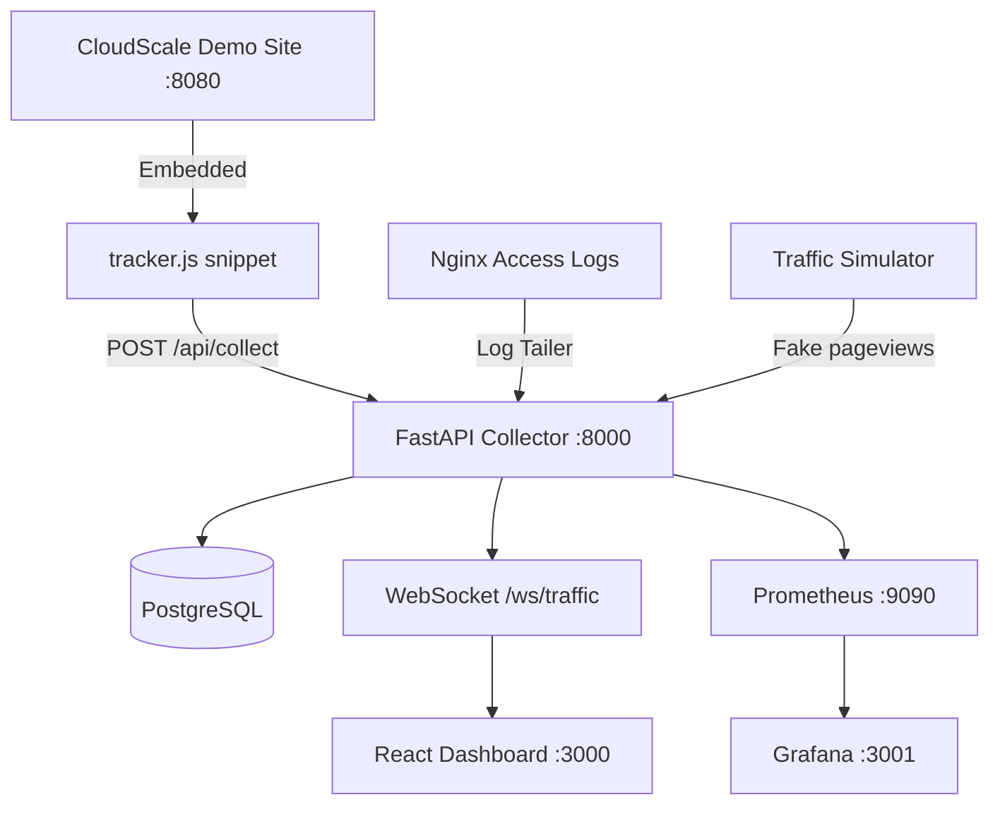
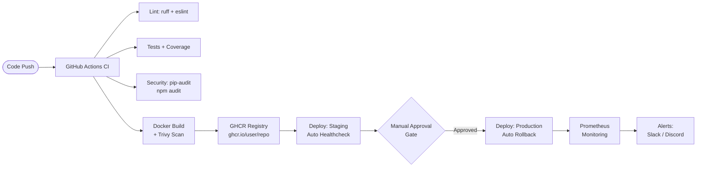

# Real-Time Web Traffic Analyzer

> A production-grade web application that collects, analyzes, and visualizes website traffic in real time — paired with a **complete, demonstrable DevOps pipeline** from code commit to cloud deployment.

---

## 🌐 Live Cloud Deployment (Render)

The application stack is fully deployed and operational in production on! [Render](https://render.com):

| Component | URL | Description |
|---|---|---|
| **📊 Real-Time Dashboard** | [web-traffic-analyzer.onrender.com](https://web-traffic-analyzer.onrender.com) | Live React telemetry dashboard with WebSocket streaming |
| **⚡ CloudScale Demo Site** | [demo-site-6524.onrender.com](https://demo-site-6524.onrender.com) | Live traffic source instrumented with `tracker.js` |
| **🚀 Collector & Analysis API** | [traffic-analyzer-api.onrender.com](https://traffic-analyzer-api.onrender.com) | FastAPI backend ([/health](https://traffic-analyzer-api.onrender.com/health) · [/docs](https://traffic-analyzer-api.onrender.com/docs)) |
| **📡 Telemetry Ingestion Endpoint** | `https://traffic-analyzer-api.onrender.com/api/collect` | High-throughput telemetry collector endpoint |

### Production Highlights
- **Automated Telemetry Dispatch**: Every page on the deployed demo site embeds `tracker.js` configured with `data-api-url="https://traffic-analyzer-api.onrender.com/api/collect"`, safely dispatching page views, link clicks, form submissions, and unloads via `fetch()` and `navigator.sendBeacon()`.
- **Dynamic CORS Integration**: The FastAPI collector supports cross-origin telemetry from all `*.onrender.com` subdomains and localhost environments.
- **Configurable Dashboard Routing**: The React frontend dashboard integrates dynamically via `VITE_API_URL` and `VITE_DEMO_URL` environment variables.

### Generating Live Traffic Against Render
You can stream simulated visitors, traffic spikes, and security anomalies directly to the cloud deployment:
```bash
# Continuous realistic visitor traffic (2 visits/sec)
python simulator/simulator.py --collector-url https://traffic-analyzer-api.onrender.com/api/collect --demo-url https://demo-site-6524.onrender.com --mode continuous --rate 2.0

# Run complete demonstration sequence (baseline -> spike -> error surge -> suspicious IP)
python simulator/simulator.py --collector-url https://traffic-analyzer-api.onrender.com/api/collect --demo-url https://demo-site-6524.onrender.com --mode demo
```

---

## 🏗️ Architecture



---

## 🔄 CI/CD Pipeline



---

## 🗂️ Project Structure

```
.
├── backend/               # FastAPI telemetry collector & analysis engine
│   ├── app/
│   │   ├── main.py        # FastAPI app, endpoints, WebSocket, startup
│   │   ├── models.py      # SQLAlchemy ORM models
│   │   ├── analytics.py   # Metrics: latency percentiles, KPIs, time-series
│   │   ├── anomaly.py     # Z-score anomaly detection + alert dispatcher
│   │   ├── parser.py      # Nginx combined log parser + UA parser
│   │   ├── metrics.py     # Prometheus instrumentation
│   │   ├── database.py    # DB session management
│   │   ├── config.py      # Settings from env vars
│   │   └── logger.py      # Structured JSON logging
│   ├── Dockerfile
│   ├── requirements.txt
│   └── requirements-dev.txt
├── frontend/              # React + Vite + Tailwind real-time dashboard
│   ├── src/
│   │   ├── App.jsx        # Main dashboard with WebSocket live feed
│   │   └── components/    # MetricCard, TimeSeriesChart, AnomalyPanel...
│   └── Dockerfile
├── demo-site/             # Static demo website (traffic generation source)
│   ├── index.html         # Home page
│   ├── products.html
│   ├── contact.html
│   ├── slow.html          # Artificial latency page
│   ├── old-page.html      # Custom 404 page
│   ├── tracker.js         # Resilient JS telemetry tracker snippet
│   ├── styles.css
│   └── Dockerfile
├── simulator/             # Automated realistic traffic generator
│   └── simulator.py
├── tests/                 # Unit, integration, smoke, and load tests
│   ├── test_log_parser.py
│   ├── test_metrics.py
│   ├── test_anomaly.py
│   ├── test_api.py
│   ├── smoke_test.py
│   └── load_test.py
├── monitoring/            # Prometheus + Grafana observability stack
│   ├── prometheus/
│   │   ├── prometheus.yml
│   │   └── alert.rules.yml
│   └── grafana/provisioning/
├── infra/terraform/       # AWS EC2 + VPC infrastructure provisioning
├── .github/workflows/     # CI + CD GitHub Actions workflows
├── docs/                  # PIPELINE.md, DEPLOY.md, DEMO.md
├── docker-compose.yml     # Full local stack orchestration
├── Makefile
└── .env.example
```

---

## 🚀 Quick Start (Local Dev)

### Prerequisites
- Docker Desktop (with Compose v2)
- Git

### 1. Clone and Setup

```bash
git clone https://github.com/YOUR_USERNAME/traffic-analyzer.git
cd traffic-analyzer

# Create env file from template (no real secrets needed for local dev)
cp .env.example .env
```

### 2. Launch Full Stack

```bash
make up
# OR equivalently:
docker compose up -d
```

### 3. Access Services

| Service | URL |
|---|---|
| **Live Telemetry Dashboard** | http://localhost:3000 |
| **CloudScale Demo Site** | http://localhost:8080 |
| **API Docs (Swagger)** | http://localhost:8000/docs |
| **API Health** | http://localhost:8000/health |
| **Prometheus** | http://localhost:9090 |
| **Grafana** | http://localhost:3001 (admin/admin) |

### 4. Generate Traffic and See Anomalies

```bash
# Option A: Full demo sequence (baseline → spike → error surge → scanner)
make demo-traffic

# Option B: Continuous simulation at 2 visits/sec
make simulate

# Option C: Individual anomaly triggers
make spike      # Traffic spike
make errors     # Error surge (404 flood)
make scanner    # Suspicious IP scanner
```

### 5. Run Tests

```bash
make test       # Unit + integration tests
make smoke      # Post-deploy smoke test against live stack
```

---

## 🔬 Analysis Features

### KPI Metrics (Live via WebSocket)
- Requests/minute, Unique visitors, Active users (last 5 min)
- Error rate %, avg/p50/p95/p99 latency
- Status code breakdown (2xx/3xx/4xx/5xx)

### Anomaly Detection (Rolling Z-Score)
- **Traffic Spike**: `z-score ≥ 2.5` on req/min vs 15-minute rolling mean
- **Error Surge**: Error rate exceeds configurable threshold (default 15%)
- **Suspicious IP**: ≥5 auth/missing errors or ≥40 requests from single IP in 5 min

### Dual Collection Sources
1. **tracker.js** embedded in demo site → `POST /api/collect`
2. **Nginx combined access logs** tailed and parsed in real time

---

## ⚙️ Configuration

All configuration is via environment variables. See [`.env.example`](.env.example).

Key variables:
| Variable | Default | Description |
|---|---|---|
| `DATABASE_URL` | SQLite (local) | PostgreSQL URL in prod |
| `Z_SCORE_THRESHOLD` | `2.5` | Anomaly sensitivity |
| `ERROR_RATE_SURGE_THRESHOLD` | `0.15` | 15% error rate trigger |
| `ALERT_WEBHOOK_URL` | (empty) | Slack/Discord webhook URL |
| `TAIL_NGINX_LOGS` | `false` | Enable Nginx log tailing |

---

## 🧪 Testing Suite

| Test File | Coverage |
|---|---|
| `test_log_parser.py` | Nginx combined log parsing, UA detection (7 browsers/OS) |
| `test_anomaly.py` | Z-score, traffic spike, error surge, IP scanner detection |
| `test_metrics.py` | Latency percentiles (avg, p50, p95, p99) |
| `test_api.py` | All API endpoints, JSON and sendBeacon ingestion |
| `smoke_test.py` | End-to-end: health → demo site → telemetry → verify |
| `load_test.py` | Locust load test: 50 users, mixed pageview/stats/events |

---

## 🔒 Security Principles

- **No secrets in repository** — `.env.example` with placeholders only
- **Non-root Docker containers** — all images run as `appuser:1000`
- **Database port closed to public** — Security Group enforces internal-only PostgreSQL access
- **Trivy vulnerability scanning** on every Docker build in CI
- **pip-audit + npm audit** on every push
- **pre-commit hooks** — ruff, trailing whitespace, secret detection

---

## 📚 Documentation

| Document | Description |
|---|---|
| [`docs/PIPELINE.md`](docs/PIPELINE.md) | Full DevOps pipeline stage-by-stage explanation |
| [`docs/DEPLOY.md`](docs/DEPLOY.md) | Exact step-by-step deployment commands |
| [`docs/DEMO.md`](docs/DEMO.md) | Live demo script for presentations |

---

## 📊 API Reference

| Endpoint | Method | Description |
|---|---|---|
| `/api/collect` | `POST` | Ingest telemetry event (JSON or text/plain beacon) |
| `/api/logs/ingest` | `POST` | Bulk ingest raw Nginx log lines |
| `/api/stats` | `GET` | Aggregated analytics (`?time_range=5m|15m|1h|24h|all`) |
| `/api/events` | `GET` | Recent raw telemetry events (`?limit=N`) |
| `/api/anomalies` | `GET` | Recent anomaly detections |
| `/ws/traffic` | `WS` | Real-time event stream (WebSocket) |
| `/health` | `GET` | Service health + DB connectivity check |
| `/metrics` | `GET` | Prometheus metrics scrape endpoint |

---

*Built with FastAPI · React · Recharts · PostgreSQL · Redis · Prometheus · Grafana · Docker · GitHub Actions · Terraform*
